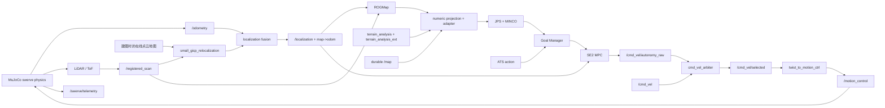

<div align="center">

# ATS MUJOCO SIMULATION

**ATS 四驱四转舵轮底盘、LiDAR/ToF、静态场地图和 Nav2-free 导航闭环的 ROS 2 MuJoCo 仿真仓库**

<p>
  
  
  
  
</p>

<p>
  
  
  
</p>

<p>
  
  
  
</p>

</div>

---

> 正式 MuJoCo 闭环使用 ATS action、ROGMap adapter、JPS/MINCO、Goal Manager 和
> 全向 SE2 MPC，不启动 Nav2 map server、costmap、lifecycle server 或 `/plan`。

## 项目简介

`ats_mujoco_sim` 提供四舵轮动力学、转向/驱动执行器、接触、传感器、定位输入、底盘协议
bridge、RMUC 场景、RViz 诊断和闭环回归入口。它用于验证从仿真传感器到
`/motion_control` 的完整软件链，而不仅是展示模型运动。

当前 2027 隧道回归使用 `models/rmuc_2027_swerve.xml` 和
`config/tunnels_2027.yaml`；`models/rmuc_2027_roof_boxes.xml` 为隧道顶板和悬空板的碰撞体。

2027 场景的地形来自 RMUC2027 V1.0.0 官方模型（2026-10-24 起；此前该文件加载的是 2025 的网格与高度场）：

- `models/meshes/rmuc_2027.obj`：官方 `2027_map/RMUC2027_V1.0.0.STL`（7522648 个三角形，毫米）经
  `scripts/decimate_stl_by_clustering.py` 顶点聚类得到（126525 个面，米）：全场 3 cm 聚类，两个隧道区域（隧道多边形外扩 1.2 m）内 1 mm。
  聚类只把落在同一个格里的顶点合并，所以比格子大的结构不会消失，表面位移不超过约一个格。MuJoCo 的射线耗时随面数增长，
  旧12000射线实验曾比较1 cm全场网格与混合网格的耗时，用于网格选型；这些旧计时不是当前10 Hz、最多20000射线/帧配置的性能。当前全场实时率仍需测量。
  官方模型本身就在地图系（x [0, 28]、y [0, 16]、z [0, 3.8]），不需要平移。MuJoCo 拒绝超过 200000 个面的 STL，所以输出 OBJ。
  这个网格同时是激光雷达的射线几何（group 2），不参与接触。隧道区域的实测值与全场 1 cm 网格逐项一致（见下）。
  用户先前提供的 `2027_map/rmuc_2027.stl`（378408 个面）缺了约 3.9 % 的表面，已不再使用。
- `models/rmuc_2027_height.png`：物理地形 hfield（560 x 320，0.05 m），由 `rmuc_hfield.py` 从同一网格生成，命令写在
  `rmuc_2027_swerve.xml` 的注释里。`--tunnel-config config/tunnels_2027.yaml` 让隧道顶板范围内高于 `roof_bottom_z` 的面
  （顶板）不进入单值 hfield，否则顶板会把隧道封死；顶板的物理碰撞由 `rmuc_2027_roof_boxes.xml` 提供。
  同一个 yaml 的 `overhangs:` 列出隧道以外的 4 块悬空板（南坡顶的 `ramp_bridge`、南侧的 `south_plate` 及其点对称），
  板下净空 0.249–0.27 m，高于车高 0.242 m（含雷达）。单值 hfield 会把板投影成实心墙，车会卡在板前
  （2026-10-30旧domain 115记录，本次未复现），所以这些板也不进hfield，改由沿y倾斜约1.5°的盒子提供碰撞；当前验收边界见主报告9.6。
- 隧道真实形状（`config/tunnels_2027.yaml`，取自网格实测，精度约 1 cm）：隧道是下沉的口袋，口袋底比两侧高台面低 0.2 m，西侧是约 9° 的缓坡；
  两侧高台块的内壁面给出 0.795 m 的净宽；顶板只是一块 0.34 m 长 x 1.12 m 宽 x 0.167 m 厚的短横梁，下表面离口袋底 0.25 m。
  `polygon` 是顶板投影，`corridor_polygon` 是两侧高台块之间的净通道，`evaluate_tunnel_pass.py` 按后者评估偏航对齐。
- 用户 PGM（`rmuc_2027.pgm`）把中央高地的轮廓画成一圈封闭的线：高地内部在 PGM 里与外部不连通（腐蚀 0 格也不连通），
  西半场与东半场之间只能从两个 0.795 m 的隧道通过。
- 回归：`test/test_rmuc_2027_scene.py`（场景不得引用 2025 资产、网格落在地图系、hfield 与网格表面一致、`tunnels_2027.yaml` 与网格实测一致、
  隧道净宽与口袋底高度）。

`rmuc_2027_mujoco.launch.py` 是 2027 入口，RMUC 2025/2026 launch 仍保留为兼容场景，
不能把旧场景结果写成 2027 隧道证据。

当前最终验收以根仓[2027最终测试方案](../../../docs/nav_acceptance/20261116_2027_final_test_plan.md)为准：
`tunnel_b_roundtrip`、`ramp_south`、`six_tunnels`，以及默认起点`(13.40,2.00)`到场景中心对称点`(14.60,14.00)`的导航速度。
红框仅保留为历史兼容；这些当前最终用例尚未新增通过，空场5m/s执行器专项不代替导航速度。

仓库支持：

- MuJoCo viewer 交互观察；
- 无 viewer/headless 自动回归；
- 与 headless 相同路线下启动完整导航 RViz；
- 独立 ROS domain 的 single、rectangle、south_corridor、red_box 路线与 P2/P3 故障注入；
- 最终位置、横移、规划 generation、离散碰撞、接触计数、速度 owner 和零命令验收。

## 目录

- [技术亮点](#技术亮点)
- [功能模块](#功能模块)
- [系统依赖](#系统依赖)
- [Quick Start](#quick-start)
- [启动方式](#启动方式)
- [节点图与参数分层](#节点图与参数分层)
- [导航目标与回归](#导航目标与回归)
- [接口与 QoS](#接口与-qos)
- [Launch 参数](#launch-参数)
- [数据流与所有权](#数据流与所有权)
- [RViz 可视化](#rviz-可视化)
- [验证结果与限制](#验证结果与限制)
- [故障排查](#故障排查)
- [目录结构](#目录结构)
- [致谢与许可证](#致谢与许可证)

## 技术亮点

### 四驱四转舵轮动力学

MuJoCo 模型分别描述四个 drive actuator、四个 steer actuator、自由车体和场地接触。
底盘控制保持车体系 `[vx, vy, wz]` 三自由度，可直接验证横移；不会把四舵轮退化为差速模型。
RMUC 2027底盘包络长×宽为0.581×0.571 m（MJCF半长/半宽0.2905/0.2855），与三套规划footprint一致；隧道通过时0.571 m宽面正对隧道，轮半径0.0425 m。通用诊断模型仍按自身MJCF几何，不代替2027几何验收。

仿真节点实现 steering rate、wheel speed/acceleration 限制、command timeout、急停和反馈发布，
并通过 `SwerveTelemetry` 暴露目标/实际轮速、转角、估计底盘命令与接触违规计数。

### LiDAR、ToF 与定位输入

内置 MID-360 扫描模式和 CPU LiDAR backend，输出 `/local_pointcloud` 与
`/registered_scan`（RMUC launch 中帧为 `odom`）。可选 ToF 输出左右和 merged point cloud。
2027 入口默认有图模式（`slam:=false`）：`small_gicp_relocalization` 将扫描与 rmuc_2027 先验 PCD 匹配。
无先验建图测试显式传 `localization_source:=lio slam:=true`，此时扫描与在线增长地图匹配。两种模式下`localization_fusion` 是 `map -> odom` 和
`/localization` 的唯一 owner，为 ROGMap、Goal Manager 和 MPC 提供定位输入。

CPU 是正式回归默认 backend；JAX/Taichi backend 为可选加速路径，只有选择对应 backend
时才需要安装其额外依赖。

### LIO 模式：仿真跑真实定位链

`localization_source:=truth|lio` 选择定位来源（默认 `truth`，行为与改动前一致）。

| 项 | `truth`（默认） | `lio` |
| --- | --- | --- |
| 定位 | 仿真直接发布真值 `/odometry`、`/registered_scan`、`odom->gimbal_yaw_odom` | 仿真只发原始传感器；`point_lio -> loam_interface -> sensor_scan_generation` 提供 `/odometry`、`/registered_scan` 与 TF |
| 时钟 | 墙钟 | 仿真发布 `/clock`，整栈 `use_sim_time:=true`；所有时间戳取 `data.time`，仿真跟不上实时只会变慢 |
| IMU | 无 | `/livox/imu`，200 Hz，加速度单位 g（`acc_norm 1.0`），挂在 `lidar_link` 内的 `mid360_imu_site` |
| 雷达 | 整帧一次快照，`/local_pointcloud` | 一帧（10 Hz）分成每段 ≤5 ms 的段，每段用对应时刻的状态追踪，每点带 `offset_time` 与 `line`；`/mujoco/livox_points`（PointCloud2）经 C++ 的 `ats_livox_adapter` 转成 `livox_ros_driver2/CustomMsg` 发到 `/livox/lidar` |
| 真值 | `/odometry` | 仅 `/simulation/ground_truth/odometry`（`map` 系，50 Hz），导航栈不得订阅 |

启动：

```bash
# 2027 场景整栈（含规划）
ros2 launch ats_mujoco_sim rmuc_2027_mujoco.launch.py localization_source:=lio
# 只跑物理 + 定位链，用于漂移 / ATE 评估
ros2 launch ats_mujoco_sim lio_localization_test.launch.py start_x:=11.25 start_y:=1.75 start_z:=0.682
python3 scripts/lio_eval.py --scenario static --duration 60 --start-x 11.25 --start-y 1.75 --out /tmp/lio_static
```

`lio` 模式的默认速率：`sim_rate_hz 400`（200 Hz IMU 的整数倍）、`lidar_rate_hz 10`、`lidar_rate_clock sim`。
`lidar_downsample 0` 表示按CPU预算自动选择密度：1 / 2–3 / ≥4个线程分别为每帧5000 / 10000 / 20000条射线；
显式正整数可覆盖密度。truth 模式物理频率默认 300 Hz，雷达同为 10 Hz 和自动密度。
20 万点/秒是 MID360 的典型点率；场景未命中的射线不生成点，因此发布点数可以更少。

雷达安装位姿由 `lidar_mount_*` 参数给出（位置、倾斜方向 `front|left`、倾角、光心离地高度）。
`lidar_mount_preset:=chassis` 应用这些参数（2027 场景默认，2026-10-31 起 2025 场景也默认，前倾 30°（实车值）、底盘前（+x）边中点内缩 0.05 m（x=0.2405, y=0）、光心离地 0.20 m）；
`legacy_gimbal` 保留模型自带的旧云台位姿（这个位姿下每帧约 33 条射线打到左后舵柱和轮子，距离 0.37–0.49 m，超出 Point-LIO 的 0.3 m 盲区，会在车周围变成地形点）。模型 `lidar_link`、`front_mid360` 静态 TF 与 Point-LIO 的 `gravity` 由同一个 `lidar_mount.chassis_mount()` 算出，不会漂移。

RViz 里的车辆模型：`use_rviz:=true` 时 `rmuc_2025_mujoco.launch.py`（所有 MuJoCo 整栈 launch 都经过它）启动一个 `robot_state_publisher`，
URDF 由 `ats_robot_description/urdf/ats_sentry.urdf.xacro` 生成（`robot_description.py`：底盘高度取 `base_footprint_height`，Mid360 位姿取与静态 TF 同一个 `MountPose`）。
根 link 是 `gimbal_yaw_odom`（底盘板），其余零件各自成 link `part_*`（RViz 一个 link 只用一种颜色），用恒等固定关节挂在根上。`robot_state_publisher` 只发布
`gimbal_yaw_odom->part_*` 的 `/tf_static`，不会和仿真自己发布的 `odom->gimbal_yaw_odom`、`gimbal_yaw_odom->base_footprint/front_mid360` 冲突。轮和舵的转角不会动（仿真不发布 `/joint_states`）。

默认 RViz 保留车辆、`/registered_scan` 当前帧点云及 `front_mid360` 坐标轴；开启累计地图与局部规划栅格，
ROG 占据/膨胀/unknown/ESDF 体素、距离场、路径和安全调试组默认关闭。可手动启用 `/mujoco/livox_points` 原始雷达点云。
底盘转动会改变雷达射线方向与原始点云；去畸变后的世界系静态障碍点保持固定位置。

MuJoCo 自带的 3D 窗口：`use_viewer:=true show_viewer:=true`。窗口在后台线程里打开，桌面锁屏时要等到解锁才会出现，仿真照常运行；
关闭这个窗口会让仿真停止。测试 runner 里用 `USE_MUJOCO_VIEWER`（默认等于 `USE_RVIZ`）。pip 的 GLFW 在这台机器上只有 Wayland 后端，窗口是原生 Wayland 窗口，`xwd` 抓不到。

轮位：所有 MJCF（`swerve.xml`、`swerve_chassis.xml`、`rmuc_2025/2026/2027_swerve.xml`）和 `kinematics.py` 的默认值都是实车的 ±0.270 m（`ats_swerve_mpc_reality.yaml` 的 `wheel_base_x/y`）；`kinematics.py` 运行时从加载的 MJCF 读 `*_steer_link` 的位置（`wheel_positions_from_model`）。

噪声默认全关（回归用），带固定种子：`enable_range_noise`（σ 2 cm）、`enable_imu_noise`（白噪声 + 零偏随机游走）、`enable_imu_saturation`（6 g / 35 rad/s），`noise_seed`。

`lidar_self_exclusion:=false` 关闭仿真对车体自身几何的排除，用来检查车体自身点（见 `scripts/mujoco_lidar_visibility_probe.py`）。

限制：LIO 模式不支持侧向 ToF。CPU 射线追踪耗时随场景复杂度增长；10 Hz 是仿真时间频率，仿真慢于实时则墙钟频率随之降低。

`lidar_threads` 默认 0，按当前进程可用 CPU affinity 的 1/3 自动选择，最少 1、最多 8；仅雷达子进程绑定该预算，
物理/导航进程的 affinity 不变，BLAS/OMP 隐式线程限制为 1。每个追踪线程持有独立 `MjData`，
结果与串行一致。密度从完整 0.1 s 扫描图案均匀抽取，降密度不改变帧周期和扫描相位。
旧 12000 射线/20 Hz 的计时不作为当前性能结论；本轮证据见根仓
[`20261116_profile_sensor_update.json`](../../../docs/nav_acceptance/20261116_profile_sensor_update.json)。

LIO模式自动启用`use_sim_time`。运动时间与健康租约使用不同的时钟，不能把所有超时都按实时率等比放大：

| 节点/参数 | 当前时钟与覆盖 |
| --- | --- |
| fusion `observation_timeout_s` | steady/wall健康窗口，基准3.0 s，LIO乘`lio_lease_wall_scale`（默认auto：无窗口4、开窗20） |
| adapter `localization_status_timeout_sec` | steady/wall健康窗口，基准1.0 s，LIO乘同一系数 |
| MPC `odometry_timeout` | 输入健康窗口，基准0.25 s，LIO乘同一系数；当前LIO扫描里程计为仿真10 Hz |
| Goal Manager `replan_stall_timeout_sec/replan_min_interval_sec` | 启用sim time时按运动ROS时间，固定4.0/2.0 s，不乘租约系数 |
| action目标timeout | 按节点时钟，LIO为`/clock`；runner另有墙钟等待预算，二者分别记录 |

旧红框和旧20 Hz扫描的超时/实时率实验只代表当时行为；不将“实时率低就设10倍租约”作为当前通用配置。先定位输入、时钟和调度问题，保留失效急停；11月16日d103/d107在首个有效身份化odom前LOST，尚无完整导航通过。

### 静态图与场景坐标一致性

`static_map_publisher` 读取 ROS map YAML 和 PGM/PNG，保留 resolution、origin、origin yaw、
occupied/free/unknown 与图像 Y 轴翻转语义，并用 RELIABLE + TRANSIENT_LOCAL 发布 `/map`。
`rmuc_2025_swerve.xml` 仅用 heightfield 表达 RMUC 2025 地形，源场景已移除
`rmuc_2025_wall_boxes.xml` 墙体 include；墙体生成器资源仍保留供其他兼容场景使用。RMUC 2025 初始
`start_z=0.381` 按起点地面高度约 0.201 m 加轮底偏置 0.180 m 计算，保证轮子落在 hfield 上。

### Nav2-free 闭环编排

`rmuc_2027_mujoco.launch.py` 直接编排：

```text
MuJoCo sensors -> small_gicp_relocalization + localization_fusion
               -> terrain_analysis(_ext) + ROGMap -> adapter
-> JPS/MINCO -> Goal Manager -> ats_swerve_mpc
-> /cmd_vel/autonomy_raw -> cmd_vel_arbiter -> /cmd_vel/selected
-> twist_to_motion_ctrl -> /motion_control -> MuJoCo
```

正式 launch 显式把 MPC `command_topic` 设为 `/cmd_vel/autonomy_raw`，把 arbiter 的 autonomy 输入覆盖为
同一 topic（`node_params.yaml` 中实车默认为 `/cmd_vel/autonomy`），并显式绑定
`planner_status_topic=/minco/planning_status`、`map_ready_topic=/rog_map_adapter/ready`；
`twist_to_motion_ctrl.input_topic` 为 `/cmd_vel/selected`。MuJoCo 不启动 fake/chassis yaw 速度变换，
也没有串口链路，因此 arbiter 显式使用 `require_serial_link:=False`；自动源仍需要
`ExecutionCommand`，手动 `/cmd_vel` 可优先覆盖。键鼠到 `/motion_control` 的运行闭环与独立物理接触 evaluator 仍为**未验证**；旧2027 `tunnel_B`无viewer片段不等于当前LIO真实B往返及六隧道最终验收通过。

## 功能模块

| 模块 | 入口 | 说明 |
| :--- | :--- | :--- |
| 物理仿真 | `ats_mujoco_sim` | 加载 XML、执行 MuJoCo step、接收底盘命令、发布状态与接触 telemetry |
| 四舵轮运动学 | `ats_mujoco_sim/kinematics.py` | `[vx, vy, wz]` 到四轮 drive/steer 目标及反馈估计 |
| LiDAR/ToF | `mujoco_lidar/`、`mid360_model.py` | CPU/JAX/Taichi ray casting、Livox 扫描模式和点云发布 |
| 静态地图 | `static_map_publisher` | 历史定位模式发布静态 `/map`，建图模式使用在线地图 |
| 速度仲裁 | `ats_cmd_vel_arbiter` 包 `cmd_vel_arbiter_node` | `/cmd_vel` 与 `/cmd_vel/autonomy_raw` 到 `/cmd_vel/selected` |
| 速度 bridge | `twist_to_motion_ctrl` | `/cmd_vel/selected` 到 `manda_can_control/msg/MotionCtrl` |
| 场地资产 | `models/`、`maps/` | RMUC 2025/2026 chassis、mesh、heightfield、wall collisions；`maps/` 内为 RMUC 2026 图 |
| 资产生成 | `generate_*`、`refine_*`、`patch_*` | 地形、场景、墙体和导航图生成/修正工具 |
| 导航编排 | `rmuc_2025_mujoco.launch.py` | 物理、static map、GICP/fusion、地形分析、ROGMap、adapter、MINCO、Goal Manager、MPC、arbiter、RViz |
| 仿真 profile | `config/rmuc_2025_navigation.yaml` | 叠加在根仓 `node_params.yaml` 之上的 RMUC 仿真参数 |
| 回归入口 | 根仓 `scripts/s3_mujoco_acceptance.py` 与 `rmuc_2027_mujoco.launch.py` | 路线、owner、终点、安全停机与跟踪证据验收 |
| 曲率分析 | 根仓 `scripts/analyze_reference_curvature.py` | 从 rosbag 计算 MINCO reference 的弧长曲率指标 |

`ats_mujoco_sim` 包本身的 console scripts 只有 `ats_mujoco_sim`、`static_map_publisher`、
`twist_to_motion_ctrl` 和上表中的资产生成工具；LiDAR/ToF 在 `ats_mujoco_sim` 进程内发布，
没有独立的 LiDAR 发布节点。

## 系统依赖

2027 场景的 CPU LiDAR 可用 Embree 索引静态场地三角网格。在仿真 Python 环境中安装
`embreex>=4.4,<5`，或安装本包的 `field_mesh` extra。启动日志中的
`【LiDAR场地网格】Embree` 表示索引已启用。其他可见物体仍由 MuJoCo 求交，
每束光选最近回波。缺少该依赖时使用原生 MuJoCo 计算全部几何。

### 基础环境

- Ubuntu 22.04；
- ROS 2 Humble；
- Python 3 与 `ament_python`；
- MuJoCo Python package；
- NumPy、SciPy、Pillow、PyYAML；
- 工作区内 `ats_sentry_bringup`（params、map、pcd）、ROGMap、adapter、MINCO、Goal Manager、
  MPC、`ats_cmd_vel_arbiter`；
- `terrain_analysis`、`terrain_analysis_ext`、`small_gicp_relocalization`；
- `manda_can_control`、`carstatemsgs` 与 ATS navigation interfaces。

安装 ROS 可解析依赖：

```bash
cd /home/ats/ATS_2026_snetry_test
source /opt/ros/humble/setup.bash
rosdep install --from-paths src --ignore-src -r -y
```

安装 Python 仿真依赖：

```bash
python3 -m pip install --user mujoco numpy scipy Pillow PyYAML
```

可选 backend：

```bash
python3 -m pip install --user jax       # 仅 lidar_backend:=jax
python3 -m pip install --user taichi    # 仅 lidar_backend:=taichi/ti
```

生产或 CI 环境建议使用锁定版本的虚拟环境/镜像；本仓当前未提供 Python lockfile，README
不声明一个未经验证的固定版本组合。

## Quick Start

### 正式工作区构建

```bash
cd /home/ats/ATS_2026_snetry_test
source /opt/ros/humble/setup.bash
MAKEFLAGS=-j1 colcon build --base-paths src --symlink-install \
  --packages-up-to ats_mujoco_sim \
  --parallel-workers 1
source install/setup.bash
```

必须使用 `--base-paths src`；单独执行 Python 或 CMake 语法检查不等价于 ROS 包级构建。

### 检查 Launch 参数

```bash
ros2 launch ats_mujoco_sim rmuc_2025_mujoco.launch.py --show-args
```

## 启动方式

先加载环境（`ROS_DOMAIN_ID` 与 DDS 配置由使用者按本机网络自行设置，文档不固定）：

```bash
source /opt/ros/humble/setup.bash
source install/setup.bash
export ROS2CLI_DISABLE_DAEMON=1
```

当前2027完整隧道回归入口：

```bash
python3 scripts/s3_mujoco_acceptance.py \
  --profile rmuc_2027_tunnels --route tunnel_b_roundtrip \
  --case route --output "${ATS_OUT:?全新的证据目录}" \
  --record-column-inputs --registration-details \
  --launch-arg lidar_threads:=0 --launch-arg lidar_downsample:=0
```

该入口无viewer，路线取自`s3_mapping_routes.yaml`，T2/T3分别选择`ramp_south`、`six_tunnels`。2027 路线默认加载 rmuc_2027 先验 PGM/PCD；加 `--mapless` 时从空图启动（`slam:=true`）。速度测试使用`SCENE=rmuc_2027 TEST_PROFILE=single`，明确起点/对称目标和`GOAL_TOLERANCE=0.08`，完整命令与曲线要求见最终方案。

当前入口是`rmuc_2027_mujoco.launch.py`，默认有图模式、viewer/RViz均关闭；下方手动示例为有图模式，显式打开对应窗口并启用LIO；测无先验时追加`slam:=true`。旧2025公共入口仍保留，其viewer默认True，与2027不同。

### MuJoCo Viewer

```bash
ros2 launch ats_mujoco_sim rmuc_2027_mujoco.launch.py \
  localization_source:=lio lidar_threads:=0 lidar_downsample:=0 \
  use_viewer:=true \
  show_viewer:=true \
  use_rviz:=false
```

`use_viewer` 控制 viewer 进程，`show_viewer` 控制窗口显示。远程或无 DISPLAY 环境不要启用。

### Headless 闭环

```bash
ros2 launch ats_mujoco_sim rmuc_2027_mujoco.launch.py \
  localization_source:=lio lidar_threads:=0 lidar_downsample:=0 \
  use_viewer:=false \
  show_viewer:=false \
  use_rviz:=false
```

这是自动化回归推荐模式，仍会运行物理、传感器、地图、定位、规划、控制和底盘 bridge。

### 完整导航 RViz

默认开启「点云」和「局部规划窗口」。用 `/registered_scan` 看当前扫描，用 `/rog_map/odom_layer` 看累计二维地图，用 `/rog_map_adapter/viz/planning_grid` 看局部栅格。有图模式下累计层叠加先验静态图；`slam:=true` 建图时从空图启动，PGM、YAML 和 PCD 由 `/rog_map/save_map` 显式导出。

```bash
ros2 launch ats_mujoco_sim rmuc_2027_mujoco.launch.py \
  localization_source:=lio lidar_threads:=0 lidar_downsample:=0 \
  use_viewer:=false \
  show_viewer:=false \
  use_rviz:=true
```

`use_rviz:=true` 会先等待 MuJoCo 仿真加载并初始化完成（若开启 `show_viewer:=true` 则先短暂等待查看器窗口就绪，不阻塞 `/clock`），随后再延时 `rviz_delay_sec`（默认 1.0 s）启动 `mujoco_navigation_rviz2`，加载
`rviz_config_file`（默认 `rviz/mujoco_navigation.rviz`）；仅在 `launch_physics:=false` 时直接按 `rviz_delay_sec` 启动。`launch_mujoco_rviz:=true` 会在物理侧
再启动一个 `ats_mujoco_sim_rviz2`，但 RMUC launch 把同一个 `rviz_config_file` 传给它，因此要看
sim-only 视图需同时指定 `rviz_config_file:=$(ros2 pkg prefix ats_mujoco_sim)/share/ats_mujoco_sim/rviz/mujoco_sim_observe.rviz`；
一般不要与完整导航 RViz 同时打开。

### 物理/导航分进程启动

```bash
ros2 launch ats_mujoco_sim rmuc_2025_physics.launch.py          # launch_navigation:=false
ros2 launch ats_mujoco_sim rmuc_2025_navigation_stack.launch.py # launch_physics:=false
```

两者都只是 include `rmuc_2025_mujoco.launch.py` 并固定 `launch_physics` / `launch_navigation`。

### 兼容入口

```bash
ros2 launch ats_mujoco_sim rmuc_2026_mujoco.launch.py
ros2 launch ats_mujoco_sim mujoco_navigation.launch.py
```

这两个文件都只转发到 `rmuc_2025_mujoco.launch.py`，不代表存在 RMUC 2026 闭环或另一套 Nav2 编排。
`planner_mujoco.launch.py` 是另一个 sim-only 入口：先按 `config/random_map.yaml` 生成随机地形，
再只启动 MuJoCo 底盘仿真，不包含导航栈。

## 节点图与参数分层

### Launch 启动的节点

`rmuc_2025_mujoco.launch.py` 中 `launch_physics:=true` 启动物理组，`launch_navigation:=true` 启动
导航组；导航组按 `TimerAction` 分批启动：

| 启动时机 | 节点名 | 包 / 可执行文件 | 参数来源 |
| :--- | :--- | :--- | :--- |
| 立即 | `ats_mujoco_sim` | `ats_mujoco_sim` / `ats_mujoco_sim`（经 `ats_mujoco_sim.launch.py`） | launch 参数 |
| `map_start_delay_sec` (1.0 s) | `static_map_publisher`（仅定位模式） | `ats_mujoco_sim` / `static_map_publisher` | launch 参数 |
| `nav_start_delay_sec` (6.0 s) | `terrain_analysis` | `terrain_analysis` / `terrainAnalysis` | `params_file` |
| 同上 | `terrain_analysis_ext` | `terrain_analysis_ext` / `terrainAnalysisExt` | `params_file` + 仿真 profile |
| 同上 | `localization_fusion` | `small_gicp_relocalization` / `localization_fusion_node` | 仅 launch 内联参数 |
| 同上 | `small_gicp_relocalization` | `small_gicp_relocalization` / `small_gicp_relocalization_node` | `params_file` + 内联；`launch_small_gicp_relocalization:=false` 可关 |
| 同上 | `ats_goal_manager` | `ats_goal_manager` / `ats_goal_manager_node` | `params_file` + 仿真 profile |
| 同上 | `minco_planner` | `minco_planner` / `minco_planner_node` | `params_file` + 仿真 profile + launch 的 yaw follow 参数 |
| 同上 | `ats_swerve_mpc` | `ats_swerve_mpc` / `ats_swerve_mpc_node` | `params_file` + 内联 |
| 同上 | `cmd_vel_arbiter` | `ats_cmd_vel_arbiter` / `cmd_vel_arbiter_node` | `params_file` + 内联 |
| 同上 | `twist_to_motion_ctrl` | `ats_mujoco_sim` / `twist_to_motion_ctrl` | 仅 launch 内联参数 |
| `rog_map_start_delay_sec` (12.0 s) | `ats_rog_map` | `ats_rog_map` / `ats_rog_map_node` | `params_file` + 仿真 profile |
| 同上 | `ats_rog_map_adapter`（与上一行同进程） | `ats_rog_map` / `ats_rog_map_node` | `params_file` + 仿真 profile；仅 `planning_grid_owner == rog_map` 时创建 |
| MuJoCo 就绪 + `rviz_delay_sec` (1.0 s) | `mujoco_navigation_rviz2` | `rviz2` | 仅 `use_rviz:=true`（先等 MuJoCo 完成加载） |

localization fusion 的内联参数包括 `odom_timeout_s=2.0`、`observation_timeout_s=3.0`、
`observation_lost_timeout_s=30.0`、`robot_base_frame=gimbal_yaw_odom`；GICP 在本 launch 中
`publish_tf=False`，只向 fusion 提供观测。

### 参数分层

同一节点的 `parameters` 列表按顺序加载，后者覆盖前者：

1. `params_file`，默认根仓 `src/ats_sentry_bringup/params/node_params.yaml`（实车 profile）；
2. `config/rmuc_2025_navigation.yaml`（安装后为 `share/ats_mujoco_sim/config/`），仅作用于
   `ats_rog_map`、`ats_rog_map_adapter`、`minco_planner`、`ats_goal_manager`、`terrain_analysis_ext`；
3. launch 内联字典（`use_sim_time`、topic 重绑定、`force_body_yaw_follow` 等）。

`ats_swerve_mpc`、`cmd_vel_arbiter`、`terrain_analysis`、`small_gicp_relocalization` 不加载仿真
profile。overlay 未写出的键沿用 `node_params.yaml`，两者都没写的键使用节点代码默认值。

### 仿真 overlay 对 `minco_planner` 的改动

下表列出当前根参数与 2025 overlay 合并后的值；2027 再叠加场景 profile。未列出的键以加载链和源码默认值为准。

| 参数 | 实车生效值 | 仿真 overlay | 说明 |
| :--- | :--- | :--- | :--- |
| `footprint_length/width` | `0.581 / 0.571` | `0.581 / 0.571` | 使用实车长宽 |
| `footprint_safety_margin` | `0.02` | `0.02` | 使用 2027 仿真每边余量 |
| `obstacle_value_threshold` | `50` | `100` | 与 adapter `terrain_obstacle_value_threshold=100` 对齐 |
| `jps_safe_distance` | `0.36` | `0.36` | 使用 2027 仿真配置；矩形足迹仍单独检查 |
| `reference_speed/max_velocity` | `5.0 / 5.0` | `5.0 / 5.0` | 暂定上限，起点保护跟随 max_velocity |
| `yaw_mode` | `clearance_aware` | `clearance_aware` | 显式写出，节点代码默认是 `goal_heading` |
| `narrow_clearance_enter/exit` | `1.20 / 1.40` | `0.55 / 0.70` | 窄通道判定滞回 |
| `yaw_tangent_symmetry_order` | 源码默认 `2` | `2` | 矩形足迹切线正反向等价 |
| `yaw_rate_limit/yaw_acceleration_limit` | `3.0 / 2.0` | `3.0 / 2.0` | 与 MPC 角速度/角加速度上限一致 |
| `yaw_tunnel_enabled/spin_enabled` | `true / true` | `true / true` | 本次用户明确授权同步 |
| `wheel_speed_time_scaling_limit` | 未启用 | 未启用 | 保留后续用户决定 |
| `escape_from_contact_enabled` | 源码默认 `false` | `true`（depth `0.05`） | 有界擦边接触，不代表物理零接触 |
| `local_repair_enabled` | `false` | `true`（search_radius `0.35 -> 0.50`） | Local Collision Repair |
| `retain_safe_reference_on_snapshot_change` | `true` | `true` | 新 snapshot 下剩余段仍过门禁则保留参考 |
| `guide_smoothing_iterations` | 源码默认 `0` | `80` | 平滑不替代最终足迹门 |
| `joint_center_clearance` | `0.54` | `0.55` | 软罚目标，与 JPS 硬门分层 |
| `joint_footprint_clearance` | `0.03` | `0.15` | 软罚目标，不是门禁 |
| `joint_footprint_edge_samples` | `1` | `4` | 每边采样点数 |
| `joint_time_budget_ms` | `15.0` | `50.0` | 其余 `joint_*` 与实车相同 |

同一 overlay 还启用有界接触逃逸、局部修复和引导平滑，修改 terrain 密度等场景参数。
本轮只统一用户指定的几何、门高、开关和速度项，其他仿真特例继续独立保留；所有实车行为仍待验证。

## 导航目标与回归

### 手工发送目标

```bash
ros2 action send_goal --feedback \
  /ats_navigate_to_pose \
  ats_navigation_interfaces/action/NavigateToPose \
  "{goal_pose: {header: {frame_id: map}, pose: {position: {x: 10.36, y: 1.49, z: 0.0}, orientation: {w: 1.0}}}, timeout: {sec: 300, nanosec: 0}}"
```

该坐标是历史red_box单目标（RMUC2025中央高地北侧），仅保留为兼容示例，不是当前最终验收；`timeout <= 0`时使用Goal Manager默认值。

### 正式 2027 验收与故障入口

根仓 `scripts/s3_mujoco_acceptance.py` 编排 `rmuc_2027_mujoco.launch.py` 与 `/ats_navigate_to_pose`，默认使用 `rmuc_2027` 有图模式（`slam:=false`，加载 `rmuc_2027.yaml`/`.pcd`），无先验显式加 `--mapless`（`slam:=true`）。脚本自动核验单一发布者所有权、独立真值误差、离散足迹冲突与 `nav_tracking_recorder.py` 的 q1/q2 跟踪结果。

```bash
# 2027 有图隧道往返（默认加载 rmuc_2027 先验，无窗口）
python3 scripts/s3_mujoco_acceptance.py \
  --profile rmuc_2027_tunnels --route tunnel_b_roundtrip \
  --output /tmp/opencode/rmuc2027_tunnel_b

# 2027 无先验建图首段与显式保存
python3 scripts/s3_mujoco_acceptance.py \
  --profile rmuc_2027 --mapless --max-goals 1 \
  --launch-arg lidar_threads:=0 --launch-arg lidar_downsample:=0 \
  --output /tmp/opencode/rmuc2027_mapless_g1
```

当前执行基地到基地、隧道与对称点速度的完整约定见[2027 导航验证方案](../../../docs/nav_acceptance/20261116_2027_final_test_plan.md)。

### 故障场景（独立 launch）

`scripts/s3_mujoco_acceptance.py --case` 支持独立故障与恢复验证：

```text
point_lio_restart  obstacle_latency  dynamic_save  unsafe  service_timeout  unknown  no_path
```

每个故障场景必须使用新的 MuJoCo launch 与隔离的 `ROS_DOMAIN_ID`（文档不固定编号），不能在同一仿真进程中串行注入多个故障后宣称独立通过。验收至少包括：

```text
emergency_stop=true -> /cmd_vel/selected=0 -> /motion_control=0
```

可恢复故障还要验证 generation 前进，且未提交新 goal 时旧执行授权/reference 不复活。

## 接口与 QoS

### 传感器、状态和控制 Topic

| Topic | 类型 | producer -> consumer | 语义/QoS |
| :--- | :--- | :--- | :--- |
| `/odometry` | `nav_msgs/msg/Odometry` | truth: MuJoCo；LIO: Point-LIO经loam/scan generation -> fusion | 模式间producer互斥，LIO不能直接用真值替代 |
| `/relocalization_observation` | `ats_navigation_interfaces/msg/RelocalizationObservation` | `small_gicp_relocalization` -> localization fusion | GICP 观测；GICP 本身不发布 TF |
| `/localization`、`/localization/status` | `nav_msgs/msg/Odometry` 等 | localization fusion -> ROGMap/Goal Manager/MPC/RViz | `/localization` 为 SensorDataQoS（BEST_EFFORT）；Goal Manager 与 MPC 均 `require_localization_status=True` |
| `/local_pointcloud` | `sensor_msgs/msg/PointCloud2` | LiDAR worker -> 诊断/感知 | 原始仿真 LiDAR，帧 `front_mid360` |
| `/registered_scan` | `sensor_msgs/msg/PointCloud2` | truth: 仿真注册；LIO: Point-LIO/loam -> ROGMap/GICP | 帧`odom`；BEST_EFFORT，LIO保留去畸变链 |
| `/mujoco/livox_points` | `sensor_msgs/msg/PointCloud2` | LIO分段LiDAR -> Livox adapter | 原始雷达帧，保留逐点时间，按仿真10 Hz |
| `/livox/imu` | `sensor_msgs/msg/Imu` | LIO仿真 -> Point-LIO | 仿真200 Hz，随底盘雷达姿态 |
| `/simulation/ground_truth/odometry` | `nav_msgs/msg/Odometry` | MuJoCo -> 独立评估 | LIO下用于map系终点及速度曲线，不作导航位姿源 |
| `/perception/tof/points_merged` | `sensor_msgs/msg/PointCloud2` | ToF worker -> terrain/诊断 | 可选，默认 RMUC 闭环关闭 ToF |
| `/cmd_vel/autonomy_raw` | `geometry_msgs/msg/Twist` | `ats_swerve_mpc` -> `cmd_vel_arbiter` | 车体系 `[vx, vy, wz]`；自主源唯一 producer |
| `/cmd_vel/selected` | `geometry_msgs/msg/Twist` | `cmd_vel_arbiter` -> `twist_to_motion_ctrl` | 手动优先；自动源须持有新鲜 `ExecutionCommand`；唯一 producer/bridge subscriber |
| `/motion_control` | `manda_can_control/msg/MotionCtrl` | `twist_to_motion_ctrl` -> MuJoCo | 唯一底盘输入 |
| `/planner/emergency_stop` | `std_msgs/msg/Bool` | Goal Manager -> MPC/MuJoCo | 急停 heartbeat |
| `/swerve/telemetry` | `ats_navigation_interfaces/msg/SwerveTelemetry` | MuJoCo -> test/evaluator | 轮速、舵角、命令和 contact diagnostics |
| `/gimbal/yaw_status` | `ats_navigation_interfaces/msg/GimbalYawStatus` | MuJoCo -> Goal Manager/MPC | RELIABLE + TRANSIENT_LOCAL |
| `/gimbal/yaw_authority_request` | `ats_navigation_interfaces/msg/YawAuthorityRequest` | Goal Manager -> MuJoCo | yaw authority 请求与确认链 |

### 底盘兼容接口

MuJoCo 还提供 `/speed_ctrl`、`/steer_ctrl`、`/motion_fb`、`/speed_fb`、`/steer_fb`、
`/system_state_fb`、`/battery_fb` 以及 `/motion_mode`、`/control_mode` service，用于底盘协议和
HIL 前的软件联调。正式自主导航的主输入仍是 `/motion_control`。

`/simulation/reset_pose` 是 `std_srvs/srv/Trigger`，仅用于将 MuJoCo 底盘原子恢复到本次启动的
`start_x/y/z/yaw`。它在同一仿真锁内清空底盘速度、旧命令、旧执行 target 和执行器 control，随后
重新前向计算；仿真时间、动态障碍物、地图/定位/规划状态与累计 contact diagnostics 不会回退。
因此它只能用于 sim-only 的可重复初态恢复，不能在运行中的导航任务里替代 cancel、emergency-stop、
新 goal 或新的 ROS domain。可通过 `reset_pose_service_topic:=""` 禁用。

### 地图与规划接口

地图、projection、planning grid、ATS action、MINCO reference 和 `ExecutionCommand` 的完整
契约见导航仓 README。仿真不得从 `/rog_map/esdf` 可视化点云重建 planner 数值 ESDF。

## Launch 参数

`rmuc_2025_mujoco.launch.py`为公共编排，下表按当前声明及LIO自动解析说明；2027入口继承后覆盖模型/资产和基地起点`(3.37,9.03,0.465,0)`，viewer/show默认False。2027 入口默认 `slam:=false`，加载 rmuc_2027 PGM/PCD；`slam:=true` 时两个先验文件参数向下传入空字符串。`lio_lease_wall_scale` 默认 `auto`：无窗口 4 倍、viewer 或 RViz 打开时 20 倍。

| 参数 | 默认值 | 说明 |
| :--- | :--- | :--- |
| `start_x/y/z/yaw` | `-0.18 / 0.06 / 0.381 / 0.0` | RMUC 2025 初始位姿，m/rad |
| `use_viewer` | `true` | 是否运行 MuJoCo viewer |
| `show_viewer` | `true` | 是否显示 viewer 窗口 |
| `use_rviz` | `false` | 是否启动完整导航 RViz |
| `launch_mujoco_rviz` | `false` | 是否在物理侧额外启动 RViz（同样使用 `rviz_config_file`） |
| `rviz_config_file` | `rviz/mujoco_navigation.rviz` | RViz 配置 |
| `rviz_delay_sec` | `1.0` | MuJoCo 初始化完成后启动 RViz 的附加延时，s |
| `launch_physics` / `launch_navigation` | `true` / `true` | 物理组 / 导航组开关 |
| `params_file` | `ats_sentry_bringup/params/node_params.yaml` | 基础参数，仿真 profile 叠加其上 |
| `map_yaml_file` | `ats_sentry_bringup/map/rmuc_2025.yaml` | static map 权威资源 |
| `prior_pcd_file` | `ats_sentry_bringup/pcd/rmuc_2025.pcd` | GICP 先验地图 |
| `launch_small_gicp_relocalization` | `true` | 运行真实 GICP；只在隔离的合成观测 fixture 中关闭 |
| `planning_grid_owner` | `rog_map` | MuJoCo保留的兼容取值；实际唯一owner为进程内adapter，不是地图后端二选一 |
| `enable_test_fault_injection` | `false` | ROGMap/adapter 测试故障授权，仅 `P2_FAULT_CASE=unknown` 置 true |
| `solver_mode` | `qp` | MPC 求解模式（仅支持 `qp`：OSQP v1.0.0 SQP-RTI） |
| `telemetry_sampling_window_cycles` | `0` | MPC 固定 telemetry 采样数，0 为滚动诊断 |
| `use_sim_time` | 声明`false` | `localization_source=lio`自动启用，整个导航栈按`/clock`运行 |
| `mujoco_odom_topic` / `fusion_odom_topic` | `/odometry` / `/odometry` | MuJoCo 发布与 fusion 订阅的里程计 |
| `sim_rate_hz` | `auto` | truth解析300 Hz，LIO解析400 Hz |
| `feedback_rate_hz` | `10.0` | 底盘反馈发布频率 |
| `truth_rate_hz` | `10.0` | truth兼容odometry；LIO独立真值使用`ground_truth_rate_hz=50` |
| `command_timeout` | `0.5` | 底盘命令 stale timeout，s |
| `freeze_motion` | `false` | 冻结底盘，传感器与定位继续运行 |
| `enable_lidar` | `true` | 启用 LiDAR worker（MID-360 模型） |
| `lidar_backend` | `cpu` | `cpu` 或已安装的可选 backend |
| `lidar_downsample` | `auto`→`0` | truth/LIO均解析自动CPU密度，正整数显式覆盖 |
| `lidar_threads` / `lidar_mount_preset` | `0` / `chassis` | 雷达子进程CPU预算与底盘固定安装 |
| `imu_rate_hz` / `lidar_segment_ms` | `200.0` / `5.0` | LIO IMU和分段扫描时序 |
| `lidar_rate_hz` / `lidar_rate_clock` / `lidar_state_rate_hz` | `auto`→`10.0` / `sim` / `30.0` | 雷达按仿真时间10 Hz；state rate不是点云帧率 |
| `enable_tof` / `tof_backend` / `tof_rate_hz` | `false` / `cpu` / `10.0` | RMUC 正式回归默认关闭 ToF |
| `force_body_yaw_follow` | `false` | 固定测试 profile 的 yaw policy，不是运行时热切换 |
| `body_yaw_follow_clearance` | `0.55` | 传给 `minco_planner` |
| `max_linear_speed` | `5.0` | bridge平面速度范数限幅，m/s；节点默认亦5.0，与当前实车出口一致 |
| `max_angular_z` | `3.0` | bridge角速度限幅，rad/s；节点默认亦3.0 |
| `map_start_delay_sec` / `nav_start_delay_sec` / `rog_map_start_delay_sec` | `1.0` / `6.0` / `12.0` | 启动排序，s |
| `log_level` | `info` | 已声明，但当前未传给任何节点 |

启动延时修改前要验证 map、projection、localization 和 action ready 的实际时间，而不是只缩短等待值。

`reset_pose_service_topic`（默认`/simulation/reset_pose`）等底层参数以实际入口转发为准。公共RMUC入口已显式暴露`max_wheel_acceleration=2.0`和`max_steer_rate=10.4719755`；不能再概括为所有轮速/舵速参数都不转发。轮速执行器加载时按5 m/s预算重设ctrlrange为±117.6470588 rad/s，保留原力矩范围；原始MJCF旧范围不代表运行时仍受旧速度截断。

## 数据流与所有权



运行期必须验证：

- `/rog_map_adapter/planning_snapshot` 只有 adapter 一个 publisher，`/rc_esdf/*` 话题不存在；
- `/cmd_vel/autonomy_raw` 只有 MPC 一个 publisher；
- `/cmd_vel/selected` 只有 arbiter 一个 publisher，bridge 只有一个 subscriber；
- `/motion_control` 只有 bridge 一个 publisher，MuJoCo 只有一个 subscriber；
- localization fusion 是 `map -> odom` 唯一动态 TF owner；
- 停止、超时和故障后最终命令与四轮 RPM 回到零。

## RViz 可视化

完整配置：

```text
rviz/mujoco_navigation.rviz
```

Fixed Frame为`odom`，Orbit 3D视图。当前生效的默认显示如下；子显示虽保留Enabled，父组关闭时不会绘制，不能据子项勾选声称调试层默认全开。

| 显示 | Topic/frame | 默认有效状态 |
| --- | --- | --- |
| 车辆、定位箭头、TF | `/localization`、`/odometry`、独立truth、TF | 开 |
| 当前帧注册点云 | `/registered_scan` | 开，Style=Points、Decay Time=0 |
| 传感器坐标轴 | `front_mid360` | 开，随底盘转动 |
| 原始LIO点云 | `/mujoco/livox_points` | 关，可手动启用 |
| ROG原生occ/inf/unknown/ESDF | `/rog_map/*` | 父组关闭 |
| 局部规划窗口、累计地图与 ROG Bounds | `/rog_map_adapter/viz/planning_grid`、`/rog_map/odom_layer`、`/rog_map/bounds` | 开 |
| Static Map | `/map` | 关 |
| 距离场与净空轮廓 | `/rog_map_adapter/viz/*` | 父组关闭 |
| JPS、MINCO和MPC路径 | 对应path话题 | 父组关闭，可手动启用 |
| 安全调试 | 快照/执行授权等 | 父组关闭 |

点云是当前观测；底盘转动时雷达轴和原始扫描转动，去畸变/注册后的静态环境留在odom中。默认关闭灰色体素与多层调试显示只改变绘制，不改变ROGMap三维滑窗或规划数值。`/rog_map_adapter/viz/*`仅在有订阅者时编码，规划链读取数值快照。

11月16日仅验证RViz配置，没有现场动态观察；截图和日志不能替代车体/雷达旋转的实际画面验收。

轻量 sim-only 配置（`/localization`、`/local_pointcloud`、`/perception/tof/points_merged`，Fixed Frame `map`）：

```text
rviz/mujoco_sim_observe.rviz
```

RViz 启动早期可能出现短暂 QoS 初始化 warning，应以最终 endpoint 表和实际数据为准；不能用
“画面可见”代替闭环结果。

## 验证结果与限制

### 2027 历史证据（不替代当前最终套件）

旧文档记录53项pytest、3项yaw CTest及局部“tunnel_B误差0.0”；这些是当时的局部结果，原始完整闭环未在本次复现，不能当作当前LIO真实B往返、六隧道或5 m/s导航通过。当前真实B在路线第10–13点，第7个ramp_bridge不算B通过。11月16日新配置的43项仿真Python回归与空场d108诊断见[专项索引](../../../docs/nav_acceptance/20261116_profile_sensor_update.json)，导航d103/d107启动失败，当前T1/T2/T3/V1/F仍未通过。


| 场景 | Domain | 结果 |
| :--- | :--- | :--- |
| Rectangle + RViz | `184` | 五段最大终点误差 `0.038681 m`；generation `313 -> 1328` |
| Rectangle headless | `186` | 五段最大终点误差 `0.041613 m`；generation `309 -> 1264` |

两例保留原 topic 名称，不能作为 `/cmd_vel/selected` 或键鼠闭环证据。两例当时均已验证：

- 五段 ATS action 完成；
- south/north 有非零 `vy` 横移；
- `/cmd_vel_mpc` 与 `/motion_control` owner 唯一；
- MINCO 离散 footprint collision sample 为 `0`；
- 最终 `/cmd_vel_mpc`、`/motion_control` 和四轮 RPM 为 `0`；
- telemetry `contact_violation_count=0`。

旧文档还记录更早red_box及9项故障的急停/双零结果；其版本、profile、注入与证据范围不能自动迁移到当前2027。最后行为修改后须重新执行对应当前路线和独立故障矩阵。

### 不得越界的结论

- `contact_violation_count=0` 只覆盖现有 MuJoCo contact evaluator，不等价于物理零碰撞；
- 离散 footprint sample 为零不是连续 swept-volume 证明；
- MuJoCo wheel/ground/contact 参数尚不能替代实车制动距离、摩擦、延迟和负载测量；
- `PlanningMapSnapshot`已是活动数值地图契约；`PlannerCandidate`/digest式原子候选契约仍未在正式链端到端迁移，不能把两者混写成地图快照尚未接入；
- HIL、抬轮测试、受限低速实车和代表性实车路线尚未执行；
- 三套profile的尺寸、余量、车高门、速度和隧道yaw/spin已同步；local repair等能力仍有profile差异，不能概括为全部仿真功能在实车关闭，也不能由参数一致推导实车通过；
- 包级 lint 仍可能受既有 copyright/flake8/pep257 债务影响，定向物理/地图测试需单列结果。

## 故障排查

### DDS 创建失败

`does not match an available interface` 或创建 domain 失败时，检查当前 shell 的 `RMW_IMPLEMENTATION`、`CYCLONEDDS_URI`、`ROS_DOMAIN_ID` 与本机实际网络是否一致。文档不规定固定的 domain 编号或 DDS 配置文件。

### 关键二进制过期

验收脚本以退出码 3 结束并输出 `stale_binary` 等字样时，按提示重新构建对应包再运行。

## 目录结构

```text
ats_mujoco_sim/
├── ats_mujoco_sim/
│   ├── sim_node.py                 # MuJoCo ROS 2 主节点（含 LiDAR/ToF 发布）
│   ├── kinematics.py               # 四舵轮运动学、限幅和接触判据
│   ├── static_map_publisher.py     # durable static map
│   ├── twist_to_motion_ctrl.py     # Twist -> MotionCtrl bridge
│   ├── dynamic_obstacles.py        # 动态障碍场景逻辑
│   ├── runtime_fault_state.py      # 运行期故障状态
│   ├── terrain_assets.py           # 地形/地图/manifest 生成
│   └── rmuc_*.py                   # RMUC heightfield、墙体和导航图工具
├── mujoco_lidar/                   # CPU/JAX/Taichi LiDAR backend、扫描模式、multiray 兼容层
├── config/
│   ├── rmuc_2025_navigation.yaml   # RMUC 仿真参数 overlay
│   └── random_map.yaml             # planner_mujoco 随机地形配置
├── launch/
│   ├── ats_mujoco_sim.launch.py    # 物理与传感器底层入口
│   ├── rmuc_2025_mujoco.launch.py  # 正式 Nav2-free 闭环
│   ├── rmuc_2025_physics.launch.py / rmuc_2025_navigation_stack.launch.py
│   ├── rmuc_2026_mujoco.launch.py / mujoco_navigation.launch.py  # 转发到 rmuc_2025
│   └── planner_mujoco.launch.py    # 随机地形 + 纯物理仿真
├── models/                         # chassis、RMUC 2025/2026 scene、mesh、heightfield
├── maps/                           # RMUC 2026 ROS occupancy map
├── rviz/                           # 完整导航与 sim-only RViz
├── test/                           # static map、物理、LiDAR、场景、复位、SIGINT 等测试
├── package.xml
└── setup.py
```

## 致谢与许可证

感谢以下开源项目和社区：

| 项目 | 在本仓中的用途 | 上游 |
| :--- | :--- | :--- |
| MuJoCo | 刚体、关节、执行器、接触和 viewer | [google-deepmind/mujoco](https://github.com/google-deepmind/mujoco) |
| ROS 2 | 节点、Topic、Service、TF、launch 与测试工具 | [ros2/ros2](https://github.com/ros2/ros2) |
| NumPy | 运动学、地图和传感器数值处理 | [numpy/numpy](https://github.com/numpy/numpy) |
| SciPy | 几何变换、地图处理和分析工具 | [scipy/scipy](https://github.com/scipy/scipy) |
| Pillow | ROS map 和 heightfield 图像读写 | [python-pillow/Pillow](https://github.com/python-pillow/Pillow) |
| PyYAML | ROS map metadata 与场景配置解析 | [yaml/pyyaml](https://github.com/yaml/pyyaml) |
| JAX / Taichi | 可选 LiDAR backend | [jax-ml/jax](https://github.com/jax-ml/jax) / [taichi-dev/taichi](https://github.com/taichi-dev/taichi) |

本仓 package 许可证为 Apache-2.0。MuJoCo、ROS 2、NumPy、SciPy、Pillow、PyYAML、JAX、
Taichi 以及模型/mesh 的再分发条件以各上游许可证和资产声明为准。
